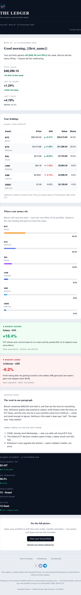

# The Ledger — Weekly Crypto Portfolio Digest

An email template built with **Hyper Elements** (`@hyper-elements/react`) for the
**Unlayer Hyper Elements Template Challenge** ($500 prize pool, 5 winners × $100,
judged on originality, design quality, practical value, effective Hyper Elements
use, and execution).

## What it is

**The Ledger** is a weekly portfolio digest a crypto holder would actually want
to open every Sunday: a "financial broadsheet" for one person's portfolio, not a
spreadsheet with a logo on top.

- **Concept & identity** — serif broadsheet headlines (Georgia), monospace
  figures (ui-monospace), and a strict navy / paper / green / red palette.
  A dark masthead band ("THE LEDGER", issue number, week dates) opens the
  email; a second dark band carries the market snapshot; white cards hold the
  content in between.
- **Sections** — (1) masthead with brand, issue and week; (2) hero summary:
  greeting with a `MergeTag` first name, total portfolio value, 24h and 7d
  change; (3) holdings table (6 assets, price / 24h / value / share, zebra
  rows); (4) allocation bars showing where the money sits; (5) top movers —
  biggest gainer and biggest loser side by side; (6) analyst note ("the week
  in one paragraph" + three things to watch next week); (7) market snapshot
  strip (total market cap, BTC dominance, Fear & Greed, ETH gas); (8) CTA
  card and a full footer (menu, social links, unsubscribe, sample-data
  disclaimer).
- **Practical value** — the template is **data-driven**: it takes a `data`
  prop (`src/data.ts`, type `DigestData`). Pass live portfolio data and the
  same template renders a real digest; with no props it renders the included
  sample week (10–16 November 2026). Nothing is filler: every section answers
  a question a holder asks on Monday morning ("am I up or down?", "what moved?",
  "what should I watch?").
- **All figures are SAMPLE DATA**, invented for demonstration, and the footer
  says so explicitly. This is not financial advice.

## Screenshot



*Full-page render of `output/digest.html` at 600px width: masthead, portfolio summary, holdings table, allocation bars, movers, analyst note, market snapshot and footer.*

## How Hyper Elements is used

The template is written entirely as Hyper Elements components — no hand-written
tables, no raw HTML, no inline `<style>` (the only raw markup in the project
is the logo PNG, embedded as a data URI for the `Image` element).

| Component | Where / how it is used |
| --- | --- |
| `Email` | Root. `width={600}`, `previewText`, `title`, `lang="en"`, `theme={ledgerTheme}`. |
| `defineTheme` + `token()` | `src/theme.ts`: the brand written once — colors, body/heading fonts, body size/line-height, Heading type scale by level, Button defaults + hover, and a named `card` style applied with `style={{ apply: ["card"] }}`. `token("colors.muted")` / `token("colors.border")` resolve theme tokens inside the template. |
| `Section` | Full-bleed bands: the dark masthead and the dark market snapshot (both with a `tokens` override so their text inherits white), and the body/footer sections that set the vertical rhythm with `padding` + `gap`. |
| `Row` / `Column` | All layout. `Row` for the masthead lockup, the three hero stats, the holdings header, and the four market stats; `Column` for the cards and every stacked block. Rows stack on phones by default. |
| `Grid columns={2}` | The top-movers pair (gainer / loser cards side by side, stacked on phones). |
| `Heading` | Serif headlines with a type scale from the theme (`level={1}` greeting, `level={2}` section titles, `level={3}` kickers). Exactly one `level={1}` in the email. |
| `Text` | Body copy, labels, figures. Monospace figures via `fontFamily`, tracked-out uppercase kickers via `letterSpacing` + `textTransform`. |
| `Span` / `LineBreak` | Colored `▲/▼` change figures inside text, and the two-line asset cells in the table (symbol, then name). |
| `Link` / `MergeTag` | `Link` for the preferences link; `MergeTag name="first_name"` personalises the greeting (`{{first_name}}` in the rendered output). |
| `Table` / `TableRow` / `TableCell` | The holdings table: a `header` row, `cellPadding` + `rowBorder` in the table style, zebra striping via `TableRow` `backgroundColor`, explicit column widths on header cells, right-aligned monospace numerics. |
| `Button` | The "View your full portfolio" CTA, with a `hover` style from the theme. |
| `Image` | The Ledger mark in the masthead: a candlestick logo drawn for this template, embedded as a data URI in `src/logo.ts` so the template is self-contained. |
| `Divider` | Hairlines under the masthead, inside the hero card, before the watch list, and above the footer. |
| `List` / `ListItem` | The numbered "Three things to watch next week" list. |
| `Menu` | Footer links (View in browser · Preferences · Unsubscribe) with a `·` separator. |
| `Social` | Footer social icons (X, Discord, Telegram). |
| `render()` / `validate()` / `outline()` | `src/render.tsx` validates the template (including the `@hyper-elements/email-clients` plugin), prints the layout outline, renders `{ html, text }`, and writes `output/digest.html` + `output/digest.txt`. |

## Run & reproduce

Requires Node.js 18+ and npm.

```bash
npm install        # installs @hyper-elements/react, react, react-dom
npm run render     # validates, outlines, renders → output/digest.html + output/digest.txt
npm run check      # hyper-elements check: validate + lint + email-client checks
npm run typecheck  # tsc --noEmit
```

Open `output/digest.html` in a browser to preview the email. `output/digest.txt`
is the plain-text version `render()` generates from the same template.

### Checks (all green)

- `npm run typecheck` — clean, no errors.
- `npm run check` — **0 errors, 0 warnings** (`hyper-elements check`
  runs `validate()`, the lint plugin, and the email-client checks).
- `npm run render` — `validate()` with the `@hyper-elements/email-clients`
  plugin passes; `render()` writes the HTML (67 KB) and plain text.

Remaining diagnostics are `info`-level only, and deliberate:

- `lint-text-size` — 12–13px labels/kickers are an intentional premium-email
  choice (section labels, footer fine print); body copy is 15px and headings
  are 20–30px.
- `outlook-degraded` — rounded corners render square in classic Outlook;
  graceful degradation, the layout itself is unaffected.
- `email/degraded` (button hover in Outlook) and `email/phone-styles`
  (a Gmail-app note) — progressive enhancement, not errors.

Two real issues the checks caught and were fixed in the code: body-text
contrast (green/red figures darkened to `#047857` / `#B91C1C` where they sit on
white, so they clear 4.5:1) and heading order (one `level={1}` only; the
masthead wordmark and the hero kicker are styled `Text`, not headings).

## Use your own data

```tsx
import Digest from "./src/Digest";
import type { DigestData } from "./src/data";

const myWeek: DigestData = { /* ... same shape as src/data.ts ... */ };
<Digest data={myWeek} />
```

The data shape is documented in `src/data.ts` (`DigestData`, `Holding`,
`Mover`, `MarketStat`). `src/data.ts` also holds the sample week the template
renders by default.

## Files

```
.
├── README.md                  — this file
├── package.json               — scripts: render / check / typecheck
├── tsconfig.json              — strict TS, jsx: react-jsx
├── .gitignore                 — node_modules, dist
├── src/
│   ├── Digest.tsx             — the template (default export; PreviewProps = {})
│   ├── data.ts                — DigestData types + the sample week
│   ├── theme.ts               — defineTheme brand + shared constants
│   ├── logo.ts                — the candlestick logo as a data URI (embedded, self-contained)
│   └── render.tsx             — validate + outline + render → output/
└── output/
    ├── digest.html            — rendered email (67 KB)
    └── digest.txt             — plain-text version
```

## Challenge submission checklist

- [x] Template built with Hyper Elements (`@hyper-elements/react` 0.4.6)
- [x] Public GitHub repository with this source + README
- [x] README explains Hyper Elements usage, includes run instructions
- [x] Screenshot/GIF of the rendered template *(full-page render in `assets/screenshot.png`)*
- [ ] Star the `hyper-elements/hyper-elements` repository
- [ ] Submit via the "Challenge Submissions" form on GitHub Discussions
      (deadline: 29 November 2026, 23:59 UTC)
